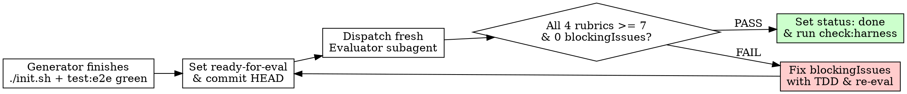

# Evaluating Features (Generator–Evaluator Separation)

## Overview

**Core principle:** The agent that builds a feature NEVER grades its own work.

**Violating the letter of this rule is violating the spirit of this rule.** Automated unit and E2E tests written by the Generator only verify cases the Generator thought of; an independent, skeptical AI Evaluator must probe the live application and score it against hard rubric thresholds before any feature can become `"done"`.

## Iron Law

```text
NO FEATURE STATUS = "done" WITHOUT AN INDEPENDENT EVALUATOR "PASS" ARTIFACT
```

If you implemented the code in the current session, you are the **Generator**. As Generator:
- You MAY set `"status": "ready-for-eval"` in `feature_list.json`.
- You MUST NOT create, edit, or backfill `evaluations/<feature-id>.json` yourself.
- You MUST NOT set `"status": "done"` until an independent Evaluator subagent writes `evaluations/<feature-id>.json` with `"verdict": "PASS"`.

## When to Use



**Always use when:**
- Finishing any feature in `feature_list.json`
- About to mark `"status": "done"` after tests pass
- Re-verifying a feature after fixing QA or UX feedback

## Separation Protocol

1. **Stage for Evaluation (Generator):**
   - Run `./init.sh` and `npm run test:e2e` (`0` errors, `0` warnings).
   - Set the feature's `"status"` to `"ready-for-eval"` in `feature_list.json` with your build/test summary in `"evidence"`.
   - Commit your work so `git rev-parse --short HEAD` identifies the exact snapshot under test.
2. **Dispatch Standalone Evaluator:**
   - Define/invoke a fresh subagent (`define_subagent` / `invoke_subagent` with `EnableWriteTools: true`, never sharing your conversation history) using [evaluator-prompt.md](evaluator-prompt.md).
   - Pass only `{FEATURE_ID}`, `{FEATURE_SPEC}` (from `feature_list.json`), `{COMMIT_SHA}`, and `{WORKSPACE_ROOT}`.
   - If visual UI changed, the Evaluator inspects the live app via Playwright/headless browser or the `browser` subagent in addition to live API probes.
3. **Act on the Verdict:**
   - **`FAIL`:** Keep `"status": "in-progress"`. Fix every item in `blockingIssues` using **REQUIRED SUB-SKILL:** `superpowers:test-driven-development`, commit the new SHA, and dispatch a fresh Evaluator pass.
   - **`PASS`:** Update `feature_list.json` `"status"` to `"done"`, append the Evaluator's scores and commit SHA to `"evidence"`, and run `./init.sh` (`npm run check:harness` mechanically verifies `evaluations/<feature-id>.json`).

## Rubric Quick Reference

| Criterion | Minimum to PASS | What the Evaluator Probes |
|-----------|-----------------|---------------------------|
| `functionalCompleteness` | `7 / 10` | Live Express + PostgreSQL data flows, edge/invalid payloads |
| `recruiterUxClarity` | `7 / 10` | Scannable hierarchy, clear CTAs, realistic recruiter value |
| `visualCraftResponsiveness` | `7 / 10` | Layout polish, mobile/desktop viewport, `0` console/network errors |
| `codeTestHygiene` | `7 / 10` | Every diff line (`git show`) traces to spec, no drive-by edits or orphan imports, real behavioral tests, `0` warnings |

## Common Rationalizations

| Excuse | Reality |
|--------|---------|
| "All unit tests, typechecks, and `test:e2e` already passed" | You wrote those tests. Self-authored tests miss UX blind spots, weak copy, broken edge states, and visual regressions. |
| "Spawning an evaluator wastes tokens / user wants to wrap up fast" | `AGENTS.md` and `npm run check:harness` mechanically block `"done"` without a valid `evaluations/<id>.json`. Skipping it breaks `./init.sh`. |
| "I'll just write `evaluations/feat-xxx.json` myself after checking localhost" | Forging an evaluator artifact as the Generator is a direct harness violation. Only a separate fresh-context subagent may author `evaluations/*.json`. |
| "`requesting-code-review` already checked the git diff" | Diff review is static. `evaluating-features` tests the live running product against PostgreSQL, HTTP endpoints, and rendered DOM. |
| "This feature is backend/infra only, UX rubric doesn't apply" | Score developer/recruiter reliability and API contract clarity honestly; every feature still undergoes independent live verification. |

## Red Flags — STOP Immediately

- About to edit `"status": "done"` when `evaluations/<feature-id>.json` does not exist yet
- Writing or editing `evaluations/<feature-id>.json` from the Generator session
- Passing your implementation chat log or excuses ("we skipped X for now") into the Evaluator prompt
- Overriding a `"FAIL"` verdict instead of fixing `blockingIssues`

**Any of these = Harness Violation. Revert status to `"ready-for-eval"` and dispatch a fresh Evaluator subagent.**
